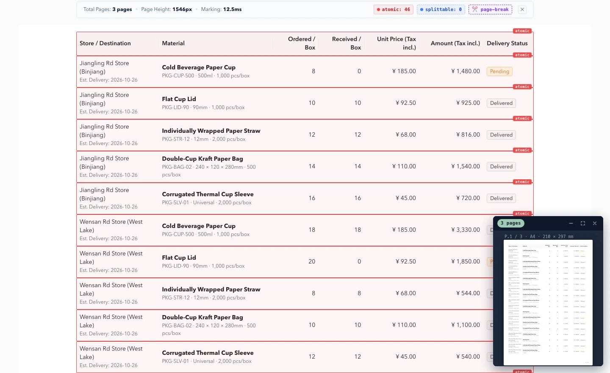

<p align="center">
  
</p>

<h1 align="center">Web Printer</h1>

<p align="center">
  <a href="./README.md">中文</a> | <strong>English</strong>
</p>

<p align="center"><strong>Preserve web page styling. Paginate naturally by content. Export PDF and images faster and more reliably.</strong></p>
<p align="center"><em>Print what you see. Break where it makes sense.</em></p>

Web Printer is a browser-side HTML pagination and export engine tailored for business reports, long tables, contracts, and articles. It addresses common pain points in [html2pdf.js](https://github.com/eKoopmans/html2pdf.js) on complex pages, such as **clipped text lines, broken table rows across pages, and blank whiteouts on long documents**.

In our benchmark tests, **5-page documents export ~2.0x faster, and complex tables export ~2.5x faster**; 20-page and 50-page long document stress tests pass page-by-page visual validation without memory crashing or blank pages. See [Benchmark Comparison](#benchmark-comparison-with-html2pdfjs).

<p align="center">
  <a href="https://www.npmjs.com/package/@darialan/web-printer"></a>
  <a href="https://github.com/darialan/web-printer/blob/master/LICENSE"></a>
  <a href="https://pdf-demo-phi.vercel.app/#/playground"></a>
</p>

[Live Demo](https://pdf-demo-phi.vercel.app/#/playground) · [npm](https://www.npmjs.com/package/@darialan/web-printer) · [Full Benchmark](https://github.com/darialan/web-printer/blob/master/docs/benchmark.md) · [Integration Guide](https://github.com/darialan/web-printer/blob/master/docs/npm-package-guide.md)



## Why Not html2pdf.js?

While `html2pdf.js` is widely known for exporting web pages to PDF, developers frequently encounter [clipped text lines](https://github.com/eKoopmans/html2pdf.js/issues/692), [broken table layouts across page boundaries](https://github.com/eKoopmans/html2pdf.js/issues/281), and [blank screen crashes on long documents](https://github.com/eKoopmans/html2pdf.js/issues/19).

The architectural difference of Web Printer: **calculate safe pagination break points first using actual DOM geometry, then render each page independently**, rather than taking a monolithic screenshot and slicing it naively by fixed pixel heights.

| Issue in Traditional Tools | How Web Printer Solves It |
| --- | --- |
| Text lines cut in half at page bottom | Measures real line-box geometry with DOM Range, breaking cleanly between lines |
| Table rows split in half, losing headers across pages | Keeps table rows intact with atomic protection, repeating headers automatically |
| Page layout reflow during printing | Measures and renders inside an isolated offscreen sandbox, leaving host DOM untouched |
| Blank pages or browser freeze on long documents (50+ pages) | Precalculates safe page breaks and renders pages individually, eliminating single-canvas size limits |

## Benchmark: Comparison with html2pdf.js

The following data was gathered in a local test suite: **html2pdf.js 0.14.0** vs. **Web Printer 3.0**. Each scenario was executed 3 times, taking the median duration.

| Test Scenario | html2pdf.js | Web Printer | Speedup / Result |
| --- | ---: | ---: | --- |
| Long Text (2 pages) | 1,761 ms | **759 ms** | **~2.3x faster** |
| Complex Table (3 pages) | 3,117 ms | **1,237 ms** | **~2.5x faster** |
| Standard Document (5 pages) | 4,382 ms | **2,167 ms** | **~2.0x faster** |
| Flex / Grid Layout | Validation Failed | **630 ms, Passed** | Visual Verification Passed |
| Long Document (20 pages) | Duplicate text markers, Validation Failed | **9.96 s, Passed** | Content Integrity Passed |
| Extra Long Document (50 pages) | Output all blank, Validation Failed | **34.98 s, Passed** | Content Integrity Passed |

<small>Test environment: macOS / Chromium 141 / A4 Portrait / DPR 1. Tested using PDF.js verifying actual exported pages, checking for blank pages and content markers.</small>

[View Full Benchmark Report (8 Scenarios & Reproduction Steps)](https://github.com/darialan/web-printer/blob/master/docs/benchmark.md)

## Quick Start

### 1. NPM Installation

```bash
npm install @darialan/web-printer
```

```ts
import { outputDocument, previewPrint, togglePageBreaks } from '@darialan/web-printer';

const el = document.getElementById('print-area')!;

// Export PDF or multipage PNG (ZIP)
await outputDocument({ element: el, filename: 'report.pdf', format: 'pdf' });

// Open virtual paper preview floating window (collapse, fullscreen, zoom, virtual scroll)
await previewPrint({ element: el });

// Toggle visual page-break guides and debug markers directly on the page
await togglePageBreaks({ element: el });
```

### 2. Standalone HTML Example (Directly runnable in HTML or JSFiddle)

```html
<button id="btn-preview">Preview Pages</button>
<button id="btn-line">Toggle Page Breaks</button>
<button id="btn-pdf">Export PDF</button>

<!-- Target printable area -->
<div id="print-area"></div>

<script type="module">
  import {
    outputPDF,
    previewPrint,
    togglePageBreaks,
  } from 'https://esm.sh/@darialan/web-printer@3.1.0';

  const el = document.getElementById('print-area');

  // Generate test blocks (data-print-atomic="true" protects cards from being cut across pages)
  el.innerHTML = Array.from({ length: 6 }, (_, i) => `
    <div data-print-atomic="true" style="height: 360px; border: 1px solid #ccc; margin: 12px 0; padding: 16px;">
      <h3>Test Block #${i + 1}</h3>
      <p>Hello there from @darialan/web-printer</p>
    </div>
  `).join('');

  // 1. Preview pages (pops up floating preview widget)
  document.getElementById('btn-preview').onclick = () => {
    previewPrint({ element: el });
  };

  // 2. Toggle visual page break lines
  document.getElementById('btn-line').onclick = () => {
    togglePageBreaks({ element: el });
  };

  // 3. Export PDF
  document.getElementById('btn-pdf').onclick = () => {
    outputPDF({ element: el, filename: 'test.pdf' });
  };
</script>
```

Also includes a specialized React Hook (`@darialan/web-printer/react`), custom headers and footers, progress callbacks, and export cancellation. See the [Integration Guide](https://github.com/darialan/web-printer/blob/master/docs/npm-package-guide.md).

## Usage Notes

- Best suited for rendered web content like invoices, receipts, contracts, reports, and articles.
- The output PDF contains rasterized pages (canvas bitmaps); text selection within the PDF is currently not supported.
- Rendering relies on `html2canvas`; certain cutting-edge CSS features and cross-origin images may be subject to browser canvas security restrictions.

[Integration Guide](https://github.com/darialan/web-printer/blob/master/docs/npm-package-guide.md) · [Benchmark](https://github.com/darialan/web-printer/blob/master/docs/benchmark.md) · [Migration Guide](https://github.com/darialan/web-printer/blob/master/docs/migration-to-v3.md) · [Issues](https://github.com/darialan/web-printer/issues)

## License

MIT
