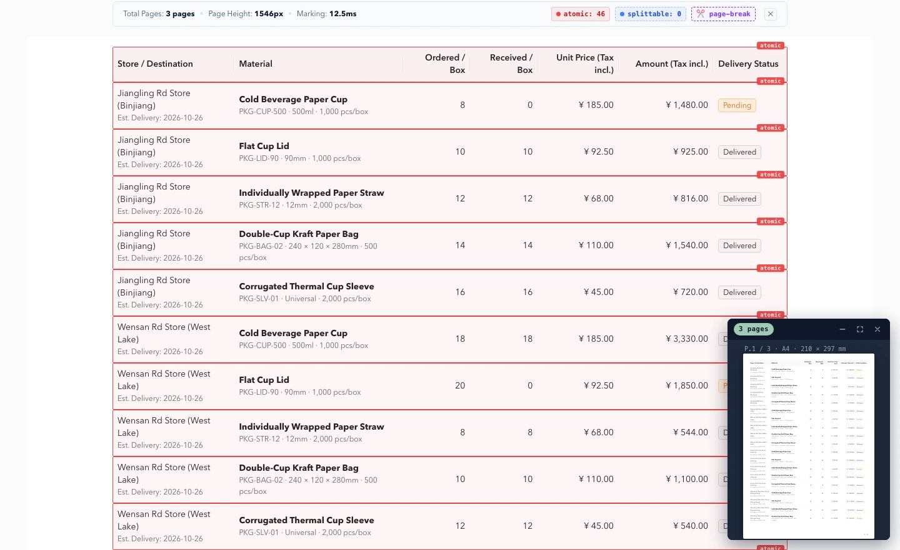

<p align="center">
  
</p>

<h1 align="center">Web Printer</h1>

<p align="center"><strong>保留网页样式，按内容分页，更快、更稳地导出 PDF 和图片。</strong></p>
<p align="center"><em>Print what you see. Break where it makes sense.</em></p>

Web Printer 是一款浏览器端 HTML 分页导出工具，适合业务报表、长表格、合同和文章。它针对 [html2pdf.js](https://github.com/eKoopmans/html2pdf.js) 在复杂页面中可能出现的**内容截断、跨页错乱和长文档白屏**问题，改进了分页和渲染流程。


在项目的本机 Benchmark 中，**5 页文档导出约快 2.0 倍，复杂表格约快 2.5 倍**；20 页和 50 页长文档测试也通过了逐页内容校验。详见下方[测试结果](#benchmark-与-html2pdfjs-对比)。

<p align="center">
  <a href="https://www.npmjs.com/package/@darialan/web-printer"></a>
  <a href="https://github.com/darialan/web-printer/blob/master/LICENSE"></a>
  <a href="https://pdf-demo-phi.vercel.app/#/playground"></a>
</p>


[在线体验](https://pdf-demo-phi.vercel.app/#/playground) · [npm](https://www.npmjs.com/package/@darialan/web-printer) · [完整 Benchmark](https://github.com/darialan/web-printer/blob/master/docs/benchmark.md) · [接入指南](https://github.com/darialan/web-printer/blob/master/docs/npm-package-guide.md)



## 为什么不直接用 html2pdf.js？

html2pdf.js 已经可以将网页导出为 PDF，但在长文档和复杂业务页面中，仍有开发者反馈[文字被截断](https://github.com/eKoopmans/html2pdf.js/issues/692)、[表格跨页问题](https://github.com/eKoopmans/html2pdf.js/issues/281)、[超长页面输出空白](https://github.com/eKoopmans/html2pdf.js/issues/19)等情况。

Web Printer 的区别在于：**先计算内容的安全分页位置，再逐页渲染**，而不是对整张长截图直接按固定高度裁切。

| 遇到的问题 | Web Printer 的处理方式 |
| --- | --- |
| 文字在页尾被切成半行 | 测量文字行的位置，优先在行与行之间分页 |
| 表格行被截断、翻页后看不到表头 | 优先保留完整表格行，支持跨页重复表头 |
| 分页后页面布局变化 | 在离屏快照中测量和渲染，尽量保留原有 CSS 布局 |
| 长文档出现空白或重复内容 | 先计算分页，再逐页生成 Canvas，避免创建一张超高截图 |

## Benchmark：与 html2pdf.js 对比

以下数据来自项目仓库的一次本机测试：**html2pdf.js 0.14.0** 对比 **Web Printer 3.0 开发代码**。每个场景重复 3 次，耗时取中位数。

| 测试场景 | html2pdf.js | Web Printer | 提升 / 结果 |
| --- | ---: | ---: | --- |
| 长文本（2 页） | 1,761 ms | **759 ms** | **快约 2.3 倍** |
| 复杂表格（3 页） | 3,117 ms | **1,237 ms** | **快约 2.5 倍** |
| 普通长文档（5 页） | 4,382 ms | **2,167 ms** | **快约 2.0 倍** |
| Flex / Grid 布局 | 校验失败 | **630 ms，通过** | 页面校验通过 |
| 长文档（20 页） | 内容标记重复，校验失败 | **9.96 s，通过** | 内容校验通过 |
| 超长文档（50 页） | 导出结果全白，校验失败 | **34.98 s，通过** | 内容校验通过 |

<small>测试环境：macOS / Chromium 141 / A4 纵向 / DPR 1。使用 PDF.js 检查实际导出的 PDF，包括空白页与内容标记。数据仅代表这些样本和测试环境</small>

[查看完整 8 组测试、原始数据口径和复现方法](https://github.com/darialan/web-printer/blob/master/docs/benchmark.md)

## 快速开始

```bash
npm install @darialan/web-printer
```

```ts
import { outputDocument } from '@darialan/web-printer';

await outputDocument({
  element: document.getElementById('report')!,
  filename: 'report',
  format: 'pdf', // 或 'png'：逐页图片并打包为 ZIP
});
```

需要让图表、签名区等内容整块换页时，可以加上标记：

```html
<div data-print-atomic="true">签名区 / 图表</div>
```

还支持 React、分页预览、导出进度与取消操作，详见[接入指南](https://github.com/darialan/web-printer/blob/master/docs/npm-package-guide.md)。

## 使用说明

- 适用于已经排版好的网页内容，例如报表、单据、合同、文章及其他打印视图。
- 输出 PDF 为位图页面，目前不支持选中或搜索其中的文字。
- 截图基于 `html2canvas`，部分 CSS 特性和跨域图片可能受到浏览器及底层库限制。

[接入指南](https://github.com/darialan/web-printer/blob/master/docs/npm-package-guide.md) · [Benchmark](https://github.com/darialan/web-printer/blob/master/docs/benchmark.md) · [迁移说明](https://github.com/darialan/web-printer/blob/master/docs/migration-to-v3.md) · [Issues](https://github.com/darialan/web-printer/issues)

## License

MIT
