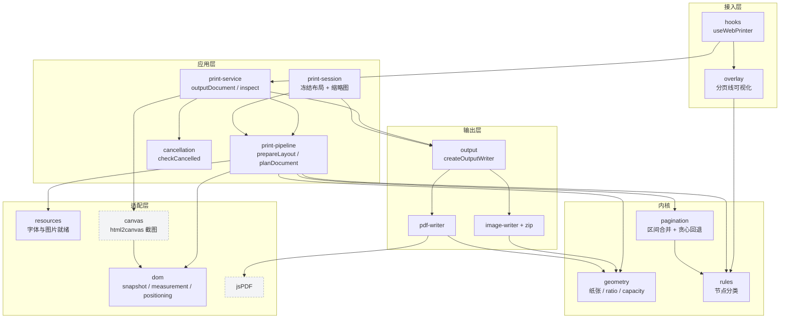
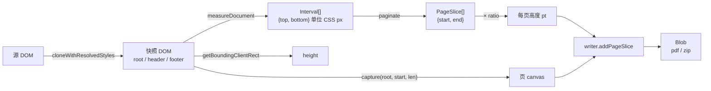
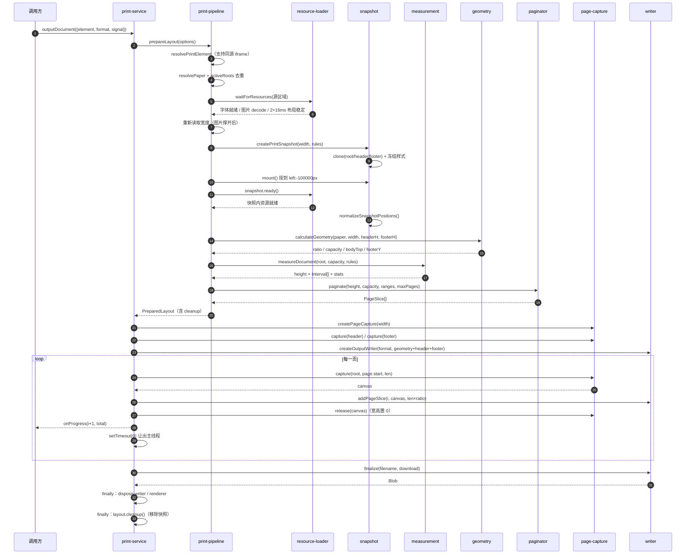
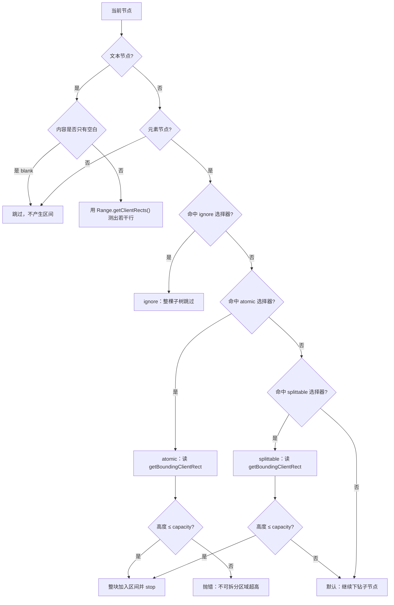
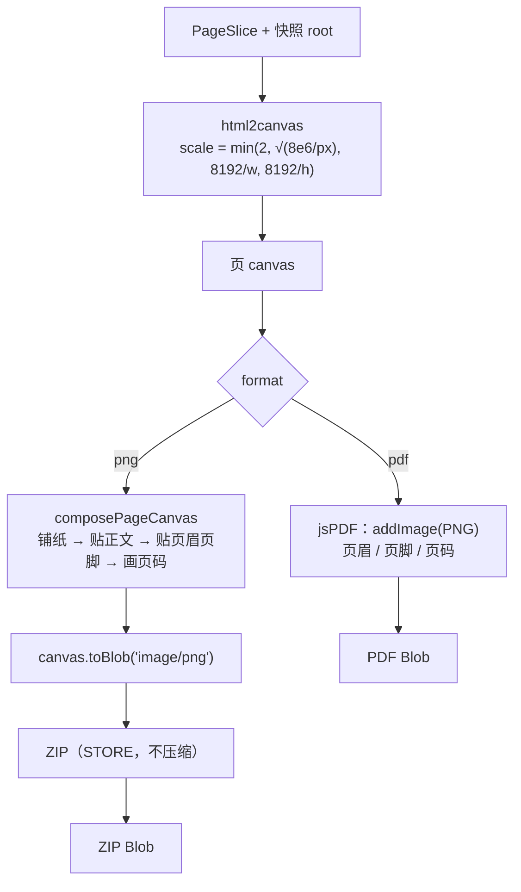
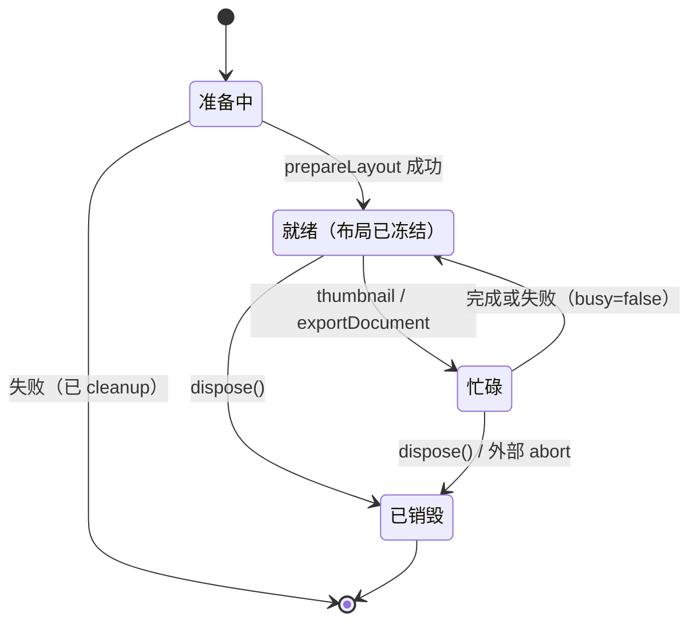
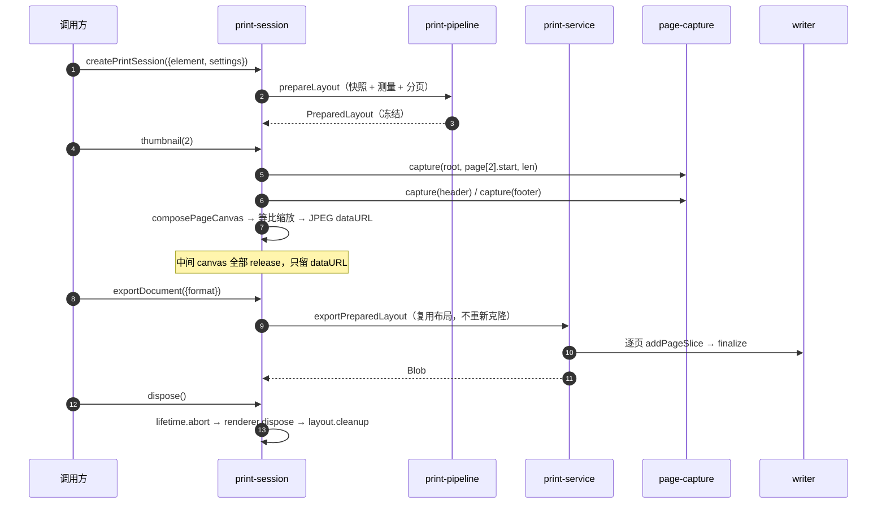

# 底层原理：一个浏览器内的 HTML 分页引擎

> 适用版本：`@darialan/web-printer` 1.1.0 · 最后核对：2026-10-31 · 状态：学习地图（以 `src/lib` 为准）

面向想读懂源码的人：先建立组件与流程的整体印象，再按第十四节的顺序读代码。

## 一、背景：它到底在解决什么

浏览器的打印能力只认「整页流式排版」，一旦内容是有样式的表格、卡片、图表，`window.print()` 就会把行切成两半、把图撕开、把工具栏一起印出来。另一条常见路数是「整页截成一张大图，再按高度平均切」——切点由纸张高度决定，和内容无关，于是照样切穿文字行。

这个库要同时满足四件事：

| 目标 | 具体含义 |
| --- | --- |
| 按内容分页 | 切点只能落在行与行之间的空隙、块与块之间的边界，不能切穿一行字 |
| 保样式 | 脱离原页面上下文后，字体、行高、宽度、定位都不变 |
| 不改源页面 | 测量与截图都在离屏副本里完成，导出前后 `document` 无变化 |
| 一套布局两种产物 | PDF 单文件、逐页 PNG 打包，共用同一份分页结果 |

换句话说：**它把「排版」和「渲染」拆开了**。排版是一次纯计算，输出只是把已算好的切片逐页画出来。

## 二、四个决定性的设计取舍

| 取舍 | 做法 | 换来了什么 |
| --- | --- | --- |
| 分页不直接操作 DOM | DOM 只被「降维」成一组受保护区间 `Interval[]`，分页交给纯函数 | 分页可单测、可毫秒级完成、与输出格式无关 |
| 测量与渲染共用同一份离屏快照 | 先克隆再测量，截图也从这份克隆上截 | 消灭「预览能看、导出不一样」 |
| 单位只在一个边界换算 | 纸张用 pt、DOM 用 CSS px，靠一个 `ratio` 连接 | 不用到处乘除，缩放不会漂移 |
| 输出层做成 writer 契约 | `addPageSlice / finalize / dispose` | 加一种格式只加一个 writer |

## 三、系统架构

五层，依赖严格单向向下；`core` 不接触任何浏览器 API，因此可以在 Node 里跑单测。



三条硬约束写在 `AGENTS.md` 里，也体现在这张图里：

1. `core` 不 import DOM / React / html2canvas / jsPDF。
2. 依赖只能向下：`hooks → application → adapters + core`，没有反向边。
3. 只有 `adapters` 层知道「浏览器」长什么样。

## 四、模块架构

### 4.1 模块与职责

| 模块 | 关键文件 | 职责 | 依赖 |
| --- | --- | --- | --- |
| 几何 | `core/geometry/paper.ts` | 纸张预设、mm↔pt↔px、校验纸张与边距 | 无 |
| 几何 | `core/geometry/page-geometry.ts` | 由纸张 + 内容宽度 + 页眉页脚算出 `ratio`、`capacity`、各基线 y | 无 |
| 规则 | `core/rules/print-rules.ts` | 将元素显式分类为 ignore / atomic / splittable；文本由 DOM 层单独测量，整块优先保护是 splittable 的附加分页偏好 | 无 |
| 分页 | `core/pagination/paginator.ts` | 合并区间、贪心回退切页、断点校验 | 无 |
| 快照 | `adapters/dom/snapshot.ts` | 克隆 + 冻结计算样式 + 保留表单/画布状态 | 规则、资源 |
| 测量 | `adapters/dom/measurement.ts` | DFS 遍历，产出受保护区间与文档高度 | 规则、text-range |
| 文本行 | `adapters/dom/text-range.ts` | 用 Selection Range 逐行测出文本行盒 | 规则 |
| 定位 | `adapters/dom/positioning.ts` | 把 sticky / fixed 冻结进文档坐标系 | 无 |
| 资源 | `adapters/resources/resource-loader.ts` | 等字体就绪、等图片 decode，15s 超时 | 规则、取消 |
| 截图 | `adapters/canvas/page-capture.ts` | 按切片截 html2canvas，管 canvas 生命周期 | html2canvas |
| 编排 | `application/print-pipeline.ts` | 快照 → 几何 → 测量 → 分页 | 以上全部 |
| 导出 | `application/print-service.ts` | 逐页截图 → writer；检查与预览入口 | pipeline、output |
| 会话 | `application/print-session.ts` | 冻结一次布局，供多张缩略图与多次导出复用 | pipeline、output |
| 输出 | `output/index.ts` + writer | PDF / PNG 两种 writer 的注册与契约 | jsPDF、ZIP |
| 接入 | `hooks/`、`overlay/` | React 状态机；分页线绘制 | 应用层 |

### 4.2 模块间的数据契约

各层之间只传三样东西：**快照 DOM**、**区间数组**、**分页切片**。



注意方向：`PageSlice` 是**唯一**在排版和输出之间流动的排版结果。PDF 与 PNG 的差别完全发生在 `writer` 内部。

## 五、一次导出的完整时序



关键点：**只有一次测量、一次分页**，页数循环里做的事只有「截图 + 贴图」，所以进度是页粒度的、内存是页粒度的。

## 六、内核 1：几何与坐标

### 6.1 纸张剖面

`calculateGeometry` 把「纸上的一条竖线」表达成一组 pt 坐标：

```text
                 pageWidth (pt)
 ┌───────────────────────────────────────────┐ 0
 │                marginTop                  │
 │          ┌─────────────────────┐          │ paper.top
 │          │  header             │          │
 │          │  headerHeight       │          │
 │          ├─────────────────────┤          │ +6pt 间距
 │          │                     │          │ bodyTop
 │          │   body 正文          │          │
 │          │   capacity × ratio  │          │
 │          │                     │          │
 │          ├─────────────────────┤          │ footerY
 │          │  footer             │          │
 │          │  footerHeight       │          │
 │          └─────────────────────┘          │
 │                marginBottom               │
 └───────────────────────────────────────────┘ pageHeight
```

公式（全部来自 `core/geometry/page-geometry.ts`）：

```text
contentWidth = pageWidth − left − right
ratio        = contentWidth / 内容宽度(px)          // 1 CSS px 对应多少 pt
headerHeight = headerPx × ratio
bodyTop      = paper.top + headerHeight + (有页眉 ? 6 : 0) + 顶部页码预留(14)
footerY      = pageHeight − bottom − 底部页码预留(14) − footerHeight
capacity     = (footerY − (有页脚 ? 6 : 0) − bodyTop) / ratio   // 单位：CSS px
```

`capacity` 是这套系统里最重要的一个数：**它是「一页能装多少像素的正文」**，也是回退分页的唯一上限。

### 6.2 `ratio` 为什么能撑住精度

- 快照里的一切（DOM 高度、行盒、元素矩形）都在 CSS px 坐标系。
- 纸张和页眉页脚在 pt 坐标系。
- 两套坐标只在这一个乘法上相遇：`pt = px × ratio`。截图时 `html2canvas` 按 `width = 内容宽度`、`x=0`、`y=切片起点` 取像素，写 PDF 时再乘 `ratio` 还原成 pt，所以无论 DPI、缩放还是纸张尺寸变化，排版比例都不会漂。

## 七、内核 2：把 DOM 降维成区间

`measureDocument` 做一次 DFS（显式栈，避免深 DOM 爆栈），每个节点先被 `classifyPrintNode` 定类：



元素分类明确为三种：`ignore`（整棵子树跳过）、`atomic`（测量整体，超高报错）与 `splittable`（递归测量子节点）。文本节点不参与元素分类，由 Range 按视觉行测量。`BASE_PRINT_RULES` 的顺序即优先级：ignore → 显式 atomic → 代码/公式 → 媒体与表单 → 标题。用户通过 `ruleConfig` 注册的选择器会被插到数组**前面**，所以能覆盖内置规则。

`BASE_SPLITTABLE_SELECTOR`（默认覆盖 `tr`、`[role="row"]`）是 splittable 元素的整块优先保护偏好：整体放得下就先保护，放不下则递归分析子节点，不报错。它与 splittable 分类分开，因此没有命中该选择器的元素仍沿 splittable 路径递归测量。

原子块命中后**不再下钻**——它的子节点没有测量价值，这也是「图片、代码块、公式整块保护」的实现方式：只是一条 `{top, bottom}`。

### 7.1 文本行为什么要单独测

元素矩形只能告诉你「这个 `<p>` 有多高」，但不能告诉你「这一行字到底占哪几个像素」——段落的 padding、`line-height` 与字形高度之间的空隙都混在 rect 里。代码用 Range 逐行取矩形，再用 `line-height` 把空隙补回来：

```text
line-height: 28px
 ┌──────────────────────────────┐  ← top − leading   (区间上界)
 │        leading 4px           │
 │  ┌────────────────────────┐  │  ← rect.top
 │  │  字形盒 20px            │  │
 │  └────────────────────────┘  │  ← rect.bottom
 │        leading 4px           │
 └──────────────────────────────┘  ← bottom + leading (区间下界)

leading = max(0, lineHeight − rect.height) / 2
```

保护区取「整行行盒」，于是分页线只可能落在相邻两行的 leading 之间，**不会压到字**。这是近似而非完整的 CSS 行盒重建：混排字体、`vertical-align` 极端值会有偏差，注释里也明说了这一点。

## 八、内核 3：贪心回退分页

### 8.1 先把区间合并

文本被拆成很多片段时，区间大量重叠。如果不合并，每页都要扫描全部区间，最坏 O(页数×区间数)。`paginate` 先排序再线性合并：

```text
排序前（重叠、乱序）
  [====]        [=======]
     [========]      [==]
合并后
  [============]      [========]
```

合并时顺便做两件事：
- 把区间夹到 `[0, height]`，丢弃空区间；
- 任一区间高度 > `capacity` 直接抛错（一张图比一页还高，无法安全分页）。

### 8.2 切页：先切，再退

```text
起点 start ─────────────────────────────────────────────►
             capacity
        ├──────────────┤ 名义切点 end
保护区：      [ 880 ......... 960 ]   ← 名义切点落在保护区内部
回退：        end = range.top = 880
本页：[start, 880)      下一页从 880 开始
```

伪代码：

```text
for start in 0..height:
    end = min(start + capacity, height)
    if end < height:
        cursor 推进到第一个 bottom > end 的区间
        if 该区间 top < end:  end = 该区间 top
    if end <= start: 抛错（容量不足，无法前进）
    push({start, end}); start = end
```

### 8.3 为什么只回退一次就够

因为区间已经**合并且互不相交**。若名义切点撞上了第 `k` 个区间，回退到 `ranges[k].top` 后，第 `k−1` 个区间的 `bottom ≤ ranges[k].top`，不可能再压住新的切点；更早的区间同理。所以一次回退必然落在安全位置，不需要循环。

这也解释了 `cursor` 的单调性：页只会向后推进，游标只增不减，整体是 O(N + P)。

| 阶段 | 复杂度 |
| --- | --- |
| 排序 | O(N log N) |
| 合并 | O(N) |
| 切页 | O(N + P)，P ≤ maxPages |

### 8.4 分页之后的复核

`inspectPrintLayout` 会在导出前再测一次**快照**，并用 `validatePageBreaks` 检查每个断点有没有穿过保护区（容差 0.25px）。之所以要重测而不是复用第一次的结果：`ignore` 节点被移除后可能引起 flex/grid 回流，源页面坐标与快照坐标已经不是一回事，只能拿快照自证。

## 九、快照：保真的真正难点

为什么不能直接截源页面？因为源页面可能在一个窄容器里、有 `fixed` 浮层、有滚动位置、有 `body` 居中 margin。克隆到离屏容器后，这些上下文全变了，布局会重排。`snapshot.ts` 用下面这组机制对抗这件事：


| 机制 | 解决的具体失效 | 代码位置 |
| --- | --- | --- |
| 逐属性冻结 computedStyle | 脱离祖先选择器后字号、行高、颜色丢失 | `copyResolvedStyle` |
| 跳过 `width/height`，但保留 `min/max` | 冻结 used value 会破坏 margin 合并与表格对齐 | 同上 |
| 媒体/表格例外 | `img/canvas/svg/table` 必须保住渲染尺寸 | 同上 |
| `body` 改挂成 `div` | html2canvas 遇到 body 目标会按文档坐标截，导致空白页 | `cloneWithResolvedStyles` |
| root 锁宽 + margin 归零 | 换容器后不再按新容器宽度重排行 | 同上 |
| sticky → relative，fixed → absolute + 锚点 | 滚动/视口相关的浮层被拍进错误位置 | `positioning.ts` |
| 挂载后用「1px 位移求逆」重算锚点 | 祖先 `transform`、`zoom`、border 会让绝对坐标失真 | `normalizeSnapshotPositions` |
| canvas 先 `toDataURL()` 探测污点 | 跨域画布会被 html2canvas 静默漏掉，改为提前报错 | `cloneWithResolvedStyles` |

定位归一化值得单独看一眼，它本质是解一个 2×2 的仿射方程组：把一个元素的 `left/top` 分别置 0、1，测两次包围盒，得到该元素「1px 本地位移 → 多少屏幕像素」的基底，再求逆把期望的文档坐标换算成本地坐标。这样即使祖先被 CSS `zoom` 或 `transform` 缩放，浮层仍落在原位置。

## 十、输出层：同一份切片，两种落地



两个 writer 共享同一份 `PageGeometry`、同一张页眉/页脚 canvas、同一套页码格式，所以两种格式的版式必然一致——差异只在「文字页码怎么画」：

- PDF：`jsPDF.text()` 用内置字体；中文页码因为内置字体没有 CJK 字形，改为先画到 640×48 的 canvas 再 `addImage`。
- PNG：直接 `ctx.fillText()`，不存在字体缺失问题。

内存策略是三段式的，任何一段超限都会明确报错而不是崩溃：

| 位置 | 上限 | 超限行为 |
| --- | --- | --- |
| 单页截图 | 800 万像素 / 单边 8192px / scale ≤ 2 | `scale < 0.5` 时抛「页面像素超限」 |
| PNG 编码累计 | 默认 128 MiB | 抛「图片总大小超过内存预算」 |
| ZIP | 65535 个条目 / 4 GiB | 抛错并提示分批导出 |
| 每页 canvas | 用后立刻 `width = height = 0` | `finally` 中释放，异常路径同样生效 |

## 十一、会话、并发与取消

`createPrintSession` 把「准备布局」这一步单独冻结出来：缩略图和导出都复用它，避免每次预览都重新克隆整个 DOM。



会话内部只有一份布局，缩略图和导出都从它切页：



取消设计有三条规则：

1. **可取消点是页边界**。`checkCancelled` 在每页开始、截图前后、writer 内各检查一次；单次 `html2canvas` 调用本身不可中断，所以取消延迟的上界是一页的渲染时间。
2. **取消信号可叠加**。会话有 `lifetime` 控制器；一次导出再建一个局部控制器，外部 `signal`、会话销毁、这次导出自己的 `signal` 任何一个触发都会 `abort`。
3. **取消也是异常**。统一抛 `导出已取消`，走同一套 `finally`：释放 canvas、`writer.dispose()`、`layout.cleanup()`。

并发用两把锁：`activeRoots`（WeakSet）阻止同一元素被两次导出同时快照；会话的 `busy` 标志阻止同一个会话上并行跑缩略图和导出。

## 十二、失败语义

错误信息是 API 的一部分——用户看到的是一句能行动的话，而不是 `undefined`。

| 报错 | 触发条件 |
| --- | --- |
| 找不到有效的打印区域 / 打印区域宽度为零 | 元素不可打印、未挂载或 `display:none` |
| 打印区域为空或超过 200,000px 高度限制 | 空内容或尺寸异常 |
| 文本超过 200,000 字符限制 | 文本测量保护阈值 |
| 不可拆分区域「X」高 Npx，超过正文可用高度 | atomic 块高于单页正文容量 |
| 页眉页脚过高，没有剩余正文空间 | `capacity ≤ 0` |
| 页面高度不足，无法安全分页 | 回退后 `end ≤ start` |
| 文档超过 N 页限制 | `maxPages`（默认 100） |
| 字体或图片加载超时 | `waitForResources` 15s |
| 图片加载失败 / 图片内容为空 | `img.decode()` 失败或 `naturalWidth = 0` |
| 画布内容无法读取 | 跨域污染，`toDataURL` 抛错 |
| 该区域正在导出，请勿重复提交 | `activeRoots` 命中 |
| 打印会话已关闭 / 正在处理上一项任务 | 会话状态校验 |

## 十三、必须守住的不变量

改动这个库时，下面几条一旦破了，就会出现「偶发空白页」「预览和导出不一样」这类难查的问题：

1. **同源**：预览、检查、导出必须用同一份快照。不要出现「拿源页面测、拿快照截」。
2. **切点安全**：任何 `PageSlice.start` 都不得落在保护区内部；跨页校验容差 0.25px。
3. **不污染源**：除 `overlay` 的临时标记（可被 `clearPageBreaks` 清除）外，不改源 DOM；所有克隆属性都写在副本上。
4. **core 纯度**：`core/` 里出现 `document`、`window`、`getBoundingClientRect` 就是分层被破坏。
5. **释放对称**：`createXxx` 必有 `dispose`；canvas 用完置 0；`prepareLayout` 的 cleanup 在成功与失败路径都要走。
6. **取消不吞异常**：取消抛错，不返回假成功。

## 十四、读代码的顺序

按数据流读，一小时能过一遍：

| 顺序 | 文件 | 读完你应该知道 |
| --- | --- | --- |
| 1 | `src/lib/index.ts` | 对外只有哪些入口 |
| 2 | `core/types.ts` | 三个核心结构：`Interval`、`PageSlice`、`PrintSettings` |
| 3 | `core/geometry/paper.ts` → `page-geometry.ts` | `ratio` 与 `capacity` 怎么来 |
| 4 | `core/rules/print-rules.ts` | ignore / atomic 节点分类与独立 splittable 分页策略 |
| 5 | `adapters/dom/traversal.ts` → `measurement.ts` → `text-range.ts` | 区间数组怎么产生 |
| 6 | `core/pagination/paginator.ts` | 切点怎么算、为什么只回退一次 |
| 7 | `adapters/dom/snapshot.ts` → `positioning.ts` | 保真靠什么 |
| 8 | `application/print-pipeline.ts` | 各阶段的顺序与清理 |
| 9 | `application/print-service.ts` | 页循环、进度、取消 |
| 10 | `output/image-writer.ts`、`adapters/pdf/jspdf-writer.ts` | 两种产物如何共用几何 |
| 11 | `application/print-session.ts` | 冻结、复用、并发与销毁 |

## 十五、已知边界

- **文本行是近似**：`leading` 均分法对混排字体、`vertical-align`、行内图片不精确；极端排版可能出现 1–2px 的视觉留白。
- **只保护「块」和「行」**：不做跨页的表格表头重复、不做孤行寡行控制（widow/orphan）。
- **依赖 html2canvas 的表达能力**：部分 CSS（复杂 `filter`、CSS 变量驱动的阴影、`backdrop-filter`）会被简化或忽略。
- **跨域资源必须可读**：图片需 CORS 头，`canvas` 不能被污染；跨域 iframe 直接拒绝。
- **单页高度是硬约束**：比一页高的图片/代码块只能报错或显式降级为可拆分。
- **并发以元素为界**：同一元素同一时刻只能有一次导出（`activeRoots`）；不同元素可并行，但会争抢主线程。

---

架构、算法、流程以代码为唯一事实来源。本文是学习用的地图，不是规范；与实现冲突时，以 `src/lib` 为准。
